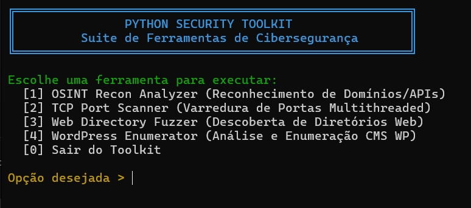

# 🛡️ Python Security Toolkit

Uma suíte modular de ferramentas de cibersegurança e reconhecimento desenvolvida em Python para fins educacionais, auditorias autorizadas e construção de portfólio técnico.

## 🚀 Ferramentas Incluídas

O toolkit é controlado centralmente através de um menu interativo (security_toolkit.py) que integra os seguintes módulos:

1. OSINT Recon Analyzer (osint_analyzer.py): Realiza reconhecimento inicial de domínios e consultas de inteligência em APIs públicas.
2. TCP Port Scanner (port_scanner.py): Varredura de portas TCP multithreaded de alta performance para mapeamento de superfícies de ataque.
3. Service Inspector (service_inspector.py): Realiza banner grabbing e inspeção de serviços ativos nas portas descobertas.
4. Web Directory Fuzzer (web_fuzzer.py): Ferramenta de descoberta de diretórios e ficheiros ocultos baseada em wordlists.
5. Web Analyzer (web_analyzer.py): Analisa cabeçalhos HTTP, extrai e lê automaticamente o conteúdo de ficheiros robots.txt e avalia redirecionamentos (301/302).
6. WordPress Enumerator (wp_enumerator.py): Focado em ambientes CMS WordPress, verifica sitemaps, valida proteções de diretórios (Directory Indexing) e deteta pegadas estruturais.

---

## 📦 Instalação e Requisitos

Certifica-te de que tens o Python instalado. O projeto utiliza as bibliotecas externas necessárias para requisições e formatação visual no terminal.

1. Clona o repositório:
git clone https://github.com/guiiparaiso/osint-recon-analyzer.git
cd osint-recon-analyzer

2. Instala as dependências necessárias:
pip install requests colorama

---

## 🎮 Como Utilizar

Para iniciar o painel de controlo central com o menu interativo, executa:

python security_toolkit.py

A partir daí, podes navegar facilmente pelas opções disponíveis através de uma interface intuitiva e parametrizada.

---

## ⚠️ Aviso Legal
Esta ferramenta foi desenvolvida estritamente para fins educacionais e de testes de segurança autorizados. O uso destas ferramentas contra alvos sem consentimento prévio explícito é ilegal.
